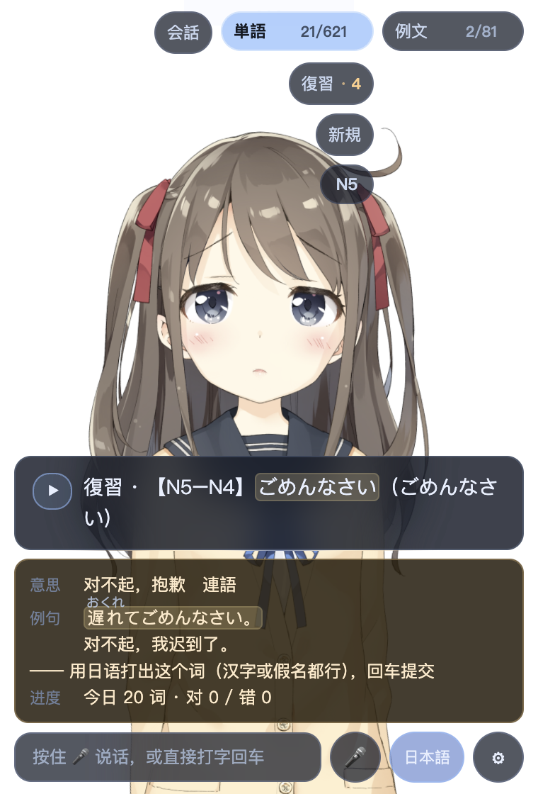

# Nihonco JP · 日语语音对话学习桌宠

一只浮在桌面上的 Live2D 角色：能听你说日语、跟你对话、讲解语法、抽查单词。
**macOS 与 Windows 都能跑**；语音识别在本机，只有对话文本发给大模型。

当前版本 **v0.7.19**（JMdict 基础读音表）· 变更见 [CHANGELOG.md](CHANGELOG.md)。



> 截图使用 Live2D 官方示例模型 Hiyori；sample data owned and copyrighted by Live2D Inc.

## 功能

| 模式 | 做什么 |
|---|---|
| **会話** | 纯聊天（日语回复 + 中文翻译），不弹纠错卡 |
| **解説** | 日本語模式下所有输入按日语处理：纠错 / 讲解 / 单词；气泡只做自然反应 |
| **単語** | 每日 20 词默写，错题本 + 间隔复习（SRS） |
| **例文** | 每日 5 个句型：复现（照打例句）或造句（规则 + LLM 判定） |

其它：

- **振假名**：单词卡、例句卡上的汉字标读音
- **回显**：语音输入「上原文 / 下译文」；中文→日语可点开看振假名、也可以怎么说、复制/朗读
- **点词查询**：气泡/例句里的日语词点一下看读音、原形、释义；词表外的词不处理
- **语音**：本机 ASR（默认 whisper.cpp，mac 可选 mlx）+ VOICEVOX / AivisSpeech 朗读
- **窗口**：可拖拽改大小，位置/尺寸持久化

## 系统要求

| 项目 | macOS | Windows |
|---|---|---|
| 系统 | macOS 13+ | Windows 10/11 x64 |
| 芯片 | Apple Silicon（M1+） | x64 |
| Node | 18+ | 18+ |
| Python | 可选，3.13（mlx 需要；`npm run setup` 建 venv） | 不需要 |
| 磁盘 | 预留 3GB；VOICEVOX 再加 2GB | 预留 4GB（Electron + whisper 模型 + VOICEVOX） |
| 常驻内存 | 主进程 + kuromoji 约 350MB；VOICEVOX 约 2GB | 同左 |

## 快速开始

### macOS

```bash
git clone https://github.com/KronosOceanus/Nihonco_JP_PBLC.git
cd Nihonco_JP_PBLC
npm ci
npm run setup          # 生成 .env、可选建 .venv
npm run setup:whisper  # 默认 ASR：编译 whisper.cpp + 下载小模型
# 编辑 .env，填 LLM_API_KEY
npm start
```

- **模型与 Cubism Core 需自备**：把 Live2D Hiyori 放到 `model/Hiyori/`，
  `live2dcubismcore.min.js` 放到 `lib/`，见 [docs/ASSETS.md](docs/ASSETS.md)
- 想要小夜的声音：装 [VOICEVOX](https://voicevox.hiroshiba.jp/)，重启应用（约 2GB）
- 也可以装 [AivisSpeech](https://aivis-project.com/speech/)，在设置 → TTS 切换；两个引擎都支持自动启停。首次切 AivisSpeech 会自动下载 BERT 模型（约 1GB+），设置页会显示下载阶段
- 想脱离 Python：`npm run setup:whisper`（Metal 版 whisper.cpp + 小模型）

### Windows

安装、GPU 加速包、打包与已知问题统一见 **[docs/windows/WINDOWS.md](docs/windows/WINDOWS.md)**。

Windows 默认 **lite** 打包（不含模型/Core，用户放到 `%APPDATA%\Nihonco\assets`）；
带资产的完整包仅维护者内部构建，公开仓库不提供。

### 构建

macOS：

```bash
npm run build:app:lite        # ASR + 应用本体，不含 Live2D
npm run build:app:lite:mlx    # lite + mlx 环境/模型
```

Windows：

```bash
npm run build:win:lite        # lite，NSIS + portable
npm run build:win:lite:dir    # 只出目录，便于先试
npm run build:win:lite:nsis
```

公开仓库只提供 lite 构建；`full` 构建仅维护者在私有仓库内部使用，不提供命令。
所有构建都会先准备 whisper.cpp。`--with-mlx` 只支持 macOS，Windows 没有 mlx。

macOS 的 lite/full `.app` 都是壳，运行时会指回项目根目录，不能单独把 `.app` 拖走；
Windows 的 lite/full 才是带资源目录的独立包。

## 配置

复制 `.env.example` 为 `.env`。最常改的：

| 变量 | 默认 | 说明 |
|---|---|---|
| `LLM_API_KEY` | — | **必填**，OpenAI 兼容接口的 key |
| `LLM_BASE_URL` | `https://api.deepseek.com/v1` | 也可指向本地 Ollama |
| `LLM_MODEL` | `deepseek-chat` | |
| `JP_LEVEL` | `N4` | 初始水平（界面可改） |
| `ASR_BACKEND` | `whispercpp` | mac：`mlx` / `whispercpp`；Windows 恒为 whisper.cpp |
| `TTS_ENGINE` | `voicevox` | `voicevox` / `aivis`，设置页切换后写回 |
| `VOICEVOX_NAME` | `小夜` | VOICEVOX 角色名 |
| `AIVIS_NAME` | `まお` | AivisSpeech 角色名 |

完整清单与说明见 [.env.example](.env.example)；ASR 模型选择见 [docs/AUDIO.md](docs/AUDIO.md)。

## 隐私

- 语音识别与语音合成都跑在本机
- 只有**对话文本**会发给配置的 LLM 服务
- 日志、词库、识别文本都在本地 `data/`，不联网
- 数据可随时导出/清空（设置 → 学习记录）

## 文档

| 文档 | 内容 |
|---|---|
| [docs/README.md](docs/README.md) | **文档地图：先看这里** |
| [docs/INSTALL.md](docs/INSTALL.md) | 安装细节、首次启动、自检 |
| [docs/ASSETS.md](docs/ASSETS.md) | 模型、VOICEVOX、AivisSpeech、Whisper 从哪获取（都不随仓库分发） |
| [docs/windows/WINDOWS.md](docs/windows/WINDOWS.md) | Windows 差异、打包、GPU、已知问题 |
| [docs/UI.md](docs/UI.md) | 模式、气泡、黄卡、回显、HUD、焦点、窗口 |
| [docs/JAPANESE-RULES.md](docs/JAPANESE-RULES.md) | 判分、黄卡规则、SRS、朗读、语言规则 |
| [docs/AUDIO.md](docs/AUDIO.md) | ASR 后端/模型/GPU、TTS 声线与朗读规范化 |
| [docs/DATA.md](docs/DATA.md) | 数据文件、schema、备份、日志 |
| [docs/ARCHITECTURE.md](docs/ARCHITECTURE.md) | 目录、进程模型、IPC、安全 |
| [docs/DEV.md](docs/DEV.md) | 测试、smoke、scan、CI |
| [docs/BOUNDARIES.md](docs/BOUNDARIES.md) | 代码/测试/加固的边界与准入规则 |
| [docs/PERSONA.md](docs/PERSONA.md) | 人格与记忆设计；阶段 1 已实现，主动/记忆未实现 |
| [docs/windows/ACCEPTANCE.md](docs/windows/ACCEPTANCE.md) | Windows 验收清单 |
| [NOTES.md](NOTES.md) | 开发日志：决策与踩坑 |
| [demo/README.md](demo/README.md) | 演示脚本：`npm run demo`，只控制应用，不录屏 |
| [CHANGELOG.md](CHANGELOG.md) | 版本记录 |

## 已知限制

- **平台前提**：默认 ASR 是 whisper.cpp；mac 可选 mlx，Windows 只能用 whisper.cpp。TTS 用 VOICEVOX 或 AivisSpeech；Windows 缺引擎时**不发音**（没有日语 SAPI）
- **识别语言手动切**：选「日本語」时说中文会被当日语转写
- **黄卡只属于「解説 + 日本語模式」**：会話不纠错；中国語模式不进入聊天/黄卡
- **自由造句的语义判定依赖 LLM**，失败时按规则结果算
- **没有发音评分 / 听力模式**；例句与词卡由模型生成，偶有不准确
- **kuromoji 常驻约 350MB**；VOICEVOX 约 2GB
- **第三方 Live2D 模型不进仓库**：`model/miku` 等为本地自用，条款多为禁止二传/商用
- **单实例运行**；打包版未签名（SmartScreen 会提示）

## 参与

- [CONTRIBUTING.md](CONTRIBUTING.md)：环境、测试、PR 规范
- [SECURITY.md](SECURITY.md)：漏洞报告
- [THIRD_PARTY_NOTICES.md](THIRD_PARTY_NOTICES.md)：第三方组件与资产条款

## License

代码采用 **PolyForm Noncommercial License 1.0.0**，见 [LICENSE](LICENSE)。

- 允许个人学习、研究、爱好项目、教育/慈善/政府机构等**非商业**用途
- **禁止任何商业用途**（包括公司内部商用）
- 这是 **source-available**，不是 OSI 开源许可证

第三方组件与资产**不在此许可证范围内**，各自适用原条款，见
[THIRD_PARTY_NOTICES.md](THIRD_PARTY_NOTICES.md)。特别是 `lib/live2dcubismcore.min.js`
（Live2D 专有 SDK）和 `model/` 下的模型，都不随仓库分发。Live2D 模型、VOICEVOX 引擎与声库
都不随仓库分发，需要用户自行从官方渠道获取。
