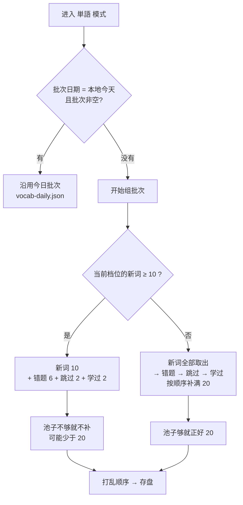
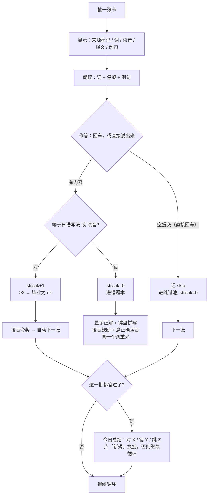
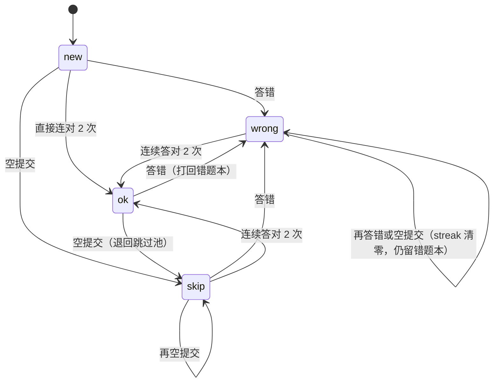
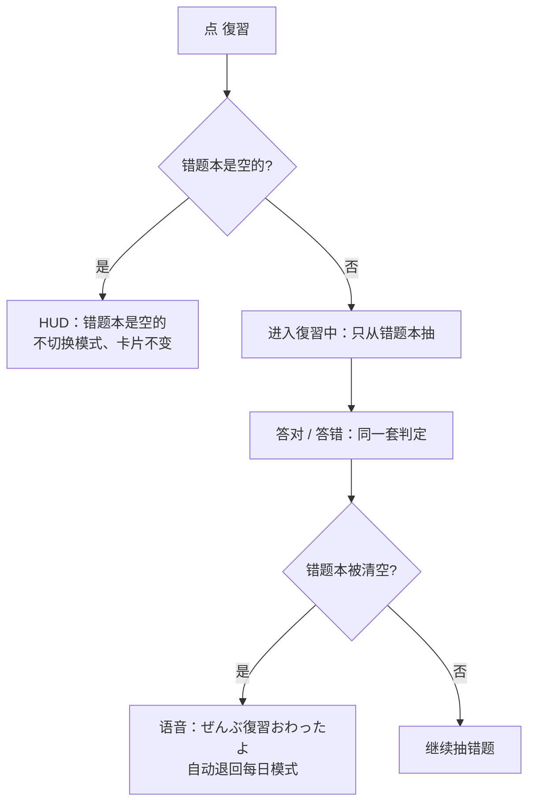
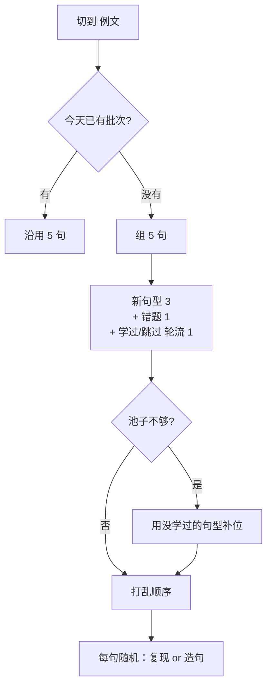

# 日语学习规则（现行）

> 本文是「Nihonco 目前怎么判、怎么复习、怎么说话」的唯一汇总。
> 改任何一条规则时，**同步改这里**，并跑对应测试（文末有清单）。
> 设计取舍与踩坑记录在 [NOTES.md](../NOTES.md)，不要写在这里。

---

## 0. 数据与等级

| 项 | 现状 |
|---|---|
| 词表 | `data/jlpt.json`，10,109 词 |
| 等级拆分 | 原表 N5–N4 合并；`data/word-levels.json` 拆出 N5 621 词，其余归 N4（未映射的也兜底 N4） |
| 默认水平 | `JP_LEVEL`，默认 **N4**；N5/N4 共用一个池（`levelToPool`） |
| 句型 | `data/patterns-n5…n1.json`，每个等级独立档位 |
| 单词档位 | 独立于句型档位（`wordbook` 记录里的 `level` / `vocab-daily.mode`） |

---

## 1. 单词卡（`agent/vocab-daily.js`）

### 1.1 每天抽什么

```
新词 10 / 错题 6 / 跳过 2 / 学过 2   （池子不够就少几个，不补）
```

- 学过池：**到期优先**（见 §4）；到期 ≥2 个时复习位 2→4，新词 10→8（总数仍 20）
- 池子不足时实际批次可能少于 20；卡片进度显示**实际总数**，不是写死的 20
- 復習模式：只轮当前档的错题；错题清空自动回每日
- 毕业：连续答对 **2 次** → `stage = "ok"`

### 1.2 判分（宽松规则）

| 规则 | 说明 |
|---|---|
| 全半角 / 大小写 / 空格 | NFKC + 去空白 + 小写 |
| 标点 / 引号 | **剥掉**（`かわいい。`、`「かわいい」` 都算对） |
| 片假名 = 平假名 | 两边 `toHiragana`（`カワイイ` 算对） |
| 汉字 = 假名 | 接受集合：`ja / kana / readingOf / alts` |
| 用户确认的写法 | 「这个也算对」写入该词 `alts`，以后自动算对 |
| 空提交 | = 跳过（进跳过池，**不影响 SRS 等级**，见 §4） |

### 1.3 「这个也算对」按钮

只在**同时满足**时出现：

```
① 判错（非空提交）
② 你的答案含汉字
③ kuromoji 读音(答案) == 卡片读音
```

- 典型用途：`かわいい → 可愛い`、`橋` 卡片被 ASR 听成 `箸`
- 同音只是必要条件（箸/橋 都是 はし）→ **仍要人工点一下**，不自动判对
- 点击后写入 `alts`，并按答对重新判一次
- 误点了：设置 → 学习记录 →「也算对记录 → 管理…」里可以删掉（也可手动添加）

### 1.4 仍然严格的

```
活用/时态：食べた ≠ 食べる
非同音错字：てきる ≠ できる
不同词：不能靠"长得像"混过去
```

### 1.5 单词卡的例句

- 来源：LLM 生成 + 本地缓存（`cachedExample`）
- 显示时汉字带**振假名**（§3）
- 只给提示，不参与判分
- **必须包含目标词**：`agent/example-check.js` 校验原词/读音/活用形/复合词
  · 生成时最多 2 次；两次都不合格 → 不显示例句，也不写缓存
  · 读缓存时同样校验；坏例句会被丢弃并重新生成
  · prompt 里明确要求「例句必须自然包含目标词或其活用形，不要用同义词替换」
- **难度跟随目标词等级**：prompt 里带上 `word.level`
  · N5–N4 词用 N5/N4 语法和常用词；N3/N2/N1 不超过该等级
  · 新缓存条目带 `level` 字段
  · 旧缓存没有 `level`，按 A 方案保留，不批量重生成
  · 词等级变了（缓存 level ≠ 当前 word.level）→ 该条例句重生成

---

## 2. 例句卡（`agent/pattern-daily.js` + `agent/patterns.js`）

每天 5 句；两种任务随机：

```
reproduce 复现：给例句，照着打
compose   造句：给中文意思 + 句型，自己造
```

### 2.0 例句怎么选

`pickExample()` 不再纯随机：

```
① 从句型里取核心（去掉（英文注释）、〜、空格，按 / 拆）
② 核心长度 ≥2：优先从包含该核心的例句里随机
③ 单字核心（な / の）或没有匹配：用第一句
```

例：

```
〜な（na-adjective） → 京都は有名な町です。（含「な」）
〜くて / 〜で        → 优先含「くて」的例句
```

### 2.1 复现（`sameSentence`）

比较顺序：

```
① normalize 后精确比（NFKC、去空白/标点/引号、小写）
② kuromoji 读音比（两边都转假名）
③ 例句自带 reading 再比
④ 旧 kanji-stems 词干表兜底（表外汉字不硬凑）
```

- 汉字/假名混写、标点差异都算对
- **同音异字会直接判对**（句子级读音一致即可，没有按钮）——这是有意设计

### 2.2 造句（`ruleMatch`）

`pattern-daily` 调用时传 `{ id: card.id }`。规则按句型形状分五支：

| 形状 | 判定 |
|---|---|
| `X〜Y`（中间型） | 各字面按顺序出现 |
| `〜X`，X 是助词（は/が/を/に/で/へ/と/も/の/や/ね/よ/か） | 两侧都有内容 + 句子像话 |
| `〜X`，X ≤2 字（短后缀） | X 作为**独立语法词**出现（分词词性：助詞/助動詞/接尾/名詞）+ 句子像话 |
| `〜X`，X >2 字（长后缀） | 出现在句中即可（最宽松） |
| `X〜`（前缀型） | 出现位置后面还有内容 |

补充：

- 多分支 `A / B`：命中任一即通过
- 含 `〜ない` 的句型：`ません / ありません / じゃありません / ありませんでした / ませんでした` 先归一成 `ない / なかった` 再判（礼貌形与普通形语义等价）
- 括号说明 `（na-adjective）` 去掉再判
- `SENTENCE_END`：`です/ます/ました/ません/でした/ください/たい/ほしい/だ/た/る/い/か/ね/よ/な/の/ある/いる/く/す/つ/ぬ/ぶ/む/ぐ/う`
- **同形句型靠 id 区分**：
  - `na-na-adjective`：`な` 后面跟名词（`有名な町`）
  - `na-prohibition`：`な` 在句尾（`泳ぐな`）
- 规则通过后，再交 LLM judge 看语义；judge 失败/超时就按规则结果算

### 2.2a 造句讲评的停留

- `ok=false`：点评 + 问题 + 改写 + 自然度，停在当前题
- `ok=true` 且 `natural <= 3` 或模型给了 `rewrite`：
  · 讲评卡显示「你的 / 地道 / 自然 / 进度」
  · 不自动下一题，点「下一句」才继续
- `ok=true` 且自然度 4–5、无 rewrite：维持自动下一题
- 批末提示用 DOM 追加，不得改 `noteEl.textContent`（会抹掉讲评卡 HTML 和按钮）

### 2.3 造句不检查的

```
活用是否正确
助词用对没有（只查"出现过"）
同义表达替换
（语义只靠可选的 LLM judge，且失败不阻塞）
```

---

## 3. 读音与振假名（`agent/reading.js`、`agent/furigana.js`）

| 项 | 现状 |
|---|---|
| 分词器 | kuromoji（IPADIC）；预热约 200ms，常驻约 350MB RSS |
| 振假名 | 她的回复、追问、例句卡例句、单词卡例句 → `<ruby>` |
| 未就绪时 | 退回纯文本；「也算对」按钮不出现（不猜） |
| 罗马字 | 只用于单词卡的键盘提示，不参与句子显示 |

限制：

```
· 读音相同 ≠ 意思对（箸/橋）
· 人名/新词可能读错（词典旧）
· 没有声调（pitch accent）
```

---

## 4. 复习与记忆（SRS）

### 4.1 间隔

```
答对：srsLevel+1 → 1 / 3 / 7 / 14 / 30 / 60 天后再出现
跳过：等级不变，只顺延到明天        ← "这次没答" ≠ "不会"
答错：等级归零，明天
```

- 存 `wordbook.json` 记录里的 `srsLevel` / `dueAt`
- 老数据没有 `dueAt` → 视为立即到期（升级后补一轮）
- `replay()` 不重算 dueAt（日志重放不改变复习计划）

### 4.2 复习模式

```
单词復習：只轮当前档错题本；清空自动回每日
例句復習：只轮当前档错题句型；错题本为空时拒绝切换
```

### 4.3 毕业

```
单词：连续答对 2 次 → stage = "ok"
例句：同样的 stage 机（patternbook）
```

---

## 5. 会話模式（`agent/prompt.js` + `agent/llm.js`）

### 5.1 说话规则

人格卡在 `agent/persona.js`；行为 few-shot 在 `agent/persona-scenes.js`。  
会話 few-shot 的 `corrections` / `explain_zh` / `words` 必须为空，避免和「本轮不出黄卡」冲突。

| 规则 | 内容 |
|---|---|
| 名字 | 永远写 `Nihonco`；问读音才用片假名 `ニホンコ`；不用平假名当表记 |
| 长度 | 日语 1–2 句，普通体，自然相づち |
| 难度 | 按当前 JLPT 等级选词/语法；难词换简单说法 |
| 追问 | 不是每轮都问；对方讲情绪/说得多时不追问；不像审问 |
| 话题 | 跟着对方的来，不反复把话题拽回电影/周末 |
| 引用 | 逐字照抄（含假名、拟声词），不"改写" |
| 网络笑声 | prompt 不规定频率；单独 `w` / `ｗ` 显示前兜底为 `（笑）`，TTS 读成 あはは |
| 纠错 | 只在 `解説` 出卡；**最多 1 件**，只挑最严重的（助词 / 活用时态 / 中文直译 / 影响理解的搭配） |
| 不纠 | です・ます 与普通体混用、语序偏好、省略 |
| 中文输入 | 日本語模式下也按日语处理；解説照常出黄卡，中国語模式只翻译 |
| 中国語模式 | 所有输入（含日语/语音）都按中文原文 `pair()` 硬翻译；不聊天、不判分、不换卡、不朗读 |
| 纠错 vs 讲解 | `why_zh` 只说这一句的具体原因（≤40 字）；`explain_zh` 讲规律/对比（≤120 字）；重复时 UI 只显示讲解 |

### 5.1.1 黄卡的出现条件

```
会話 + 任何输入        → 不出黄卡（纯聊天）
解説 + 任何输入        → 纠错 / 讲解 / 单词（日本語模式全部按日语）
中国語模式             → 不进入 chat / 黄卡，只翻译

语言由 speakLang 决定：ja / zh；不再用文本猜语言
主进程 agent/turn.js 的 applyCardPolicy 会强制清空非解説的三个字段
```

### 5.2 上下文

```
history：内存保留最近 16 轮（32 条消息）；发给模型最近 8 轮（16 条消息）
assistant 历史：只存 { reply_ja, reply_zh, next_question_ja } 的精简 JSON
切模式：不清空历史；重启丢失
```

### 5.3 学过的词（`agent/targets.js`）

```
来源：wordbook 里 stage = "ok"
档位：不高于当前档
冷却：同一个词 7 天内不重复
数量：每轮 ≤2
用法：拼进 system prompt，明确「自然才用、不硬塞、不列举」
记录：命中写 data/usage.json；日志 [targets] picked/used
```

### 5.4 容错

```
JSON 坏格式：洗控制字符 → 重试解析 → 字段恢复 → 友好兜底句
response_format 不被支持：去掉重试一次
```

---

## 6. 语音输入（ASR）

| 项 | 现状 |
|---|---|
| 后端 | 默认 whisper.cpp；mac 可选 mlx；Windows 只 whisper.cpp |
| 契约 | `GET /health`、`POST /asr?lang=&prompt=` |
| 热词 | 当天单词批次 + 错题池，≤60 字，只保留词表里有的词 |
| 语言 | 手动切 日本語 / 中国語；日本語全部按日语进入当前模式，中国語只翻译；气泡固定「原文 + 翻译」 |
| 结束 | 停顿 N 秒自动发送（默认 1.2s，1–5 可调）；几乎无声判「没录到声音」 |
| 同音 | 单词模式：读音一致可点「这个也算对」；复现题：读音一致直接算对 |
| 启动自检 | 只在确定起不来时提示；`ready:false`（模型加载中）不算失败 |

**没解决的**：ASR 把词听错且读音也不同（例如漏字），仍会判错。

---

## 7. 朗读（TTS，`agent/speech-text.js`）

```
1) 文本规范化（规则表，按引擎作用域）
2) VOICEVOX / AivisSpeech audio_query + synthesis
3) 缓存（key 含 RULES_VERSION 与引擎，改规则旧缓存自动失效）
```

规则表（`RULES_VERSION = 2`）：

| id | 作用 |
|---|---|
| `name-nihonco` | `Nihonco` → にほんこ（读法） |
| `laugh-haha` | 句首/标点后的「はは」→「あはは」（防 ワワ） |
| `laugh-kakko` | `（笑）` → あはは（所有引擎） |
| `laugh-w-start / laugh-w-after` | 单个/多个 `w` / `ｗ` → あはは（防字母念法） |
| `latin-ai / ok / live2d / pc` | 拉丁缩写 → 片假名读法 |
| `num-year` | 四位数 + 年 → 正确读法 |
| `sym-ellipsis` | 省略号 → 短停顿 |

- 启动自检：当前引擎不可用时只提示缺引擎，不再回落 `say`
- emoji / 变体选择符直接删除
- macOS 缺引擎：不发声，HUD 提示
- Windows 缺引擎：**不发音**，HUD 提示，抛 `TTS_NO_JA_VOICE`
- 双引擎切换由 `main/voice.js` 管理；切换期间模型下拉显示「引擎启动中…」

---

## 8. 宽松规则速查

| 输入场景 | 宽松点 | 严格点 |
|---|---|---|
| 单词 | 标点、全半角、片假名、`alts`、同音可人工确认 | 活用、非同音错字 |
| 复现 | 标点、汉字/假名混写、读音一致 | 读音不同 |
| 造句 | 标点、多分支、括号、助词/后缀位置、id 特判 | 活用、助词用法、语义（LLM judge） |
| 会话 | JSON 容错、纠错只 1 件、引用逐字 | 名字表记、读音表记 |
| 朗读 | 读音规则表、缓存 | — |

---

## 9. 已知限制

```
· 无发音评分（长音/促音/浊音/声调都不评）
· 复现题同音异字直接判对（句子级，不人工确认）
· 单词模式不接受活用形（食べた ≠ 食べる）
· 造句只查"句型出现过"，不查语法是否正确（语义靠 LLM，可能失败）
· 没有听力/听写/朗读练习
· 会话没有长期记忆（重启就忘）
· ASR 语言=ja 仍可能吐中文；有脚本守卫，但全汉字共享字/噪声可能漏
· 振假名没有开关
· kuromoji 常驻约 350MB（磁盘 17MB）
```

---

## 10. 改规则时改哪里

| 规则 | 代码 | 测试 |
|---|---|---|
| 单词判分 / alts | `agent/vocab-daily.js`、`agent/wordbook.js` | `tests/vocab-daily.test.mjs`、`tests/alts.test.mjs` |
| 复现 / 造句 | `agent/patterns.js`、`agent/pattern-daily.js` | `tests/patterns.test.mjs` |
| 读音 / 振假名 | `agent/reading.js`、`agent/furigana.js` | `tests/reading.test.mjs` |
| SRS | `agent/wordbook.js`、`agent/vocab-daily.js` | `tests/vocab-daily.test.mjs` |
| 会话 prompt | `agent/prompt.js`、`agent/llm.js` | `tests/prompt-quote.test.mjs`、`tests/llm-parse.test.mjs`、`tests/persona.test.mjs` |
| 人格 / few-shot | `agent/persona.js`、`agent/persona-scenes.js` | `tests/persona.test.mjs` |
| 学过的词 | `agent/targets.js` | `tests/targets.test.mjs` |
| 单词例句校验 | `agent/example-check.js`、`agent/enrich.js` | `tests/example-check.test.mjs` |
| 例句卡选句 | `agent/patterns.js`（`pickExample`） | `tests/patterns-example.test.mjs` |
| 朗读规则 | `agent/speech-text.js` | `tests/tts-cache-key.test.mjs`（改规则记得 bump `RULES_VERSION`） |
| 语音识别 | `agent/asr-*.js`、`asr.py` | `tests/asr-contract.test.mjs` |
| 语言污染守卫 | `agent/lang-guard.js`、`main/ipc.js`、`renderer/rec.js` | `tests/lang-guard.test.mjs` |

---

## 附：每日批次与状态机

### 档位怎么分工

三个档位互相独立，只有一种联动：

```
单词档位 == 例文档位  →  全局档位自动变成这个值
（否则全局保持不动，单词/例文各练各的）
```

- 全局档位：决定对话/解説的日语难度（点它会弹下拉）
- 升级按钮已取消：换档直接用各自的档位下拉
- 单词档位：每日 20 词从哪一档抽（池子不足时批次会少于 20，界面显示实际总数）
- 例文档位：每日 5 句从哪一档抽（N5–N1 五档都有数据，全部可选）


> 下面几张图是当前实现的真实逻辑，改代码前先看这里。

### 1. 每日批次怎么组出来的（単語模式）



### 2. 一次默写的完整流程



### 3. 单词状态机（错题本的本质）



要点：**毕业条件只有一个 —— 连续答对 2 次**。中间的答错会清零重来。

### 4. 復習模式（错题本专项）



### 4.5 例文模式（句型）怎么组批



判定：**复现**比对例句（标点空格不限；汉字写法、全假名、**汉字+假名混合**都算对，混合靠 `data/kanji-stems.json` 转写）；**造句**先用句型字面校验，再让模型看语义（模型不可用时按规则结果）。

和单词模式的对应关系（同构部分）：

| 维度 | 单词 | 例文 |
|---|---|---|
| 出卡语音 | 词 + 例句 | 例句（可「再读一遍」） |
| 答对 | 夸奖语音 + 自动下一张 | 同（复用同一套台词池） |
| 答错 | 鼓励语音 + 正解 | 鼓励语音 + 提示 + 例句 |
| 新規 | 换 20 词 + 语音提示 | 换 5 句 + 语音提示 |
| 一批答完 | 总结提示 | 同 |
| 新内容提示 | 新词答完 | 新句型答完 |
| 进度 | 练过的词 / 该档总词数（只出现不算） | 练过的句型 / 该档句型数 |
| 数据兜底 | 追加日志 + 基线 | 同（`patternbook.log.jsonl`） |

---

## 「也算对」记录的管理界面

- 数据层：`wordbook.listAlts()` / `removeAlt(ja, alt)` / `setAlts(ja, alts)`
  · 比较用 NFKC + 去空白 + 小写；`setAlts` 会排除和 ja/kana 相同的写法
- IPC：`cfg:alts-list` / `cfg:alts-remove` / `cfg:alts-set`（仅设置窗口）
- UI：设置 → 学习记录 →「也算对记录 → 管理…」，展开后每个词一行，chip 上的 × 删除，
  行尾输入框 + ＋ 添加；删除不二次确认（按需求）
- alts 仍是字符串数组，不带时间戳（以后要排序再加 `{v, at}` 结构）

## 输入语言（模式决定）

- `speakLang` 是唯一语言来源：
  · 日本語模式 → `ja`：会話聊天、解説出黄卡、单词/例句答题
  · 中国語模式 → `zh`：任何文本/语音只翻译，不进入 chat
- 不再用 `detectLang()` 根据假名/文本猜语言；`agent/lang.js` 已删除
- `finalizeTurn()` 仍收口：先 `normalizeFollowUp()` 去重，再 `applyCardPolicy()` 清字段
- 无卡时 `showNote` 会清空 `noteEl.textContent`（以前只加 `gone`，DOM 里会留上一条）

---

## 2026-11 行为变更

以下是最近改动过、和判分/展示直接相关的规则：

### 点词查询

```
范围：会話/解説气泡的日语正文；黄卡与例文卡的例句（.jp）
不处理：目标词本身、中文翻译/讲解、回显、标签/按钮/输入框
数据：kuromoji + 词表（JLPT 10k）
命中：原词 / 原形 / 词表释义；词表外不显示、不可点
浮层：读音、原形、释义、等级/词性；小喇叭按词表读音朗读
```

- 实现：`agent/lookup.js`、`renderer/lookup.js`、`pet:lookup`
- 点词浮层不需要 `fromSettings`；它只读词表，不写学习数据

### 单词卡进度

```
卡片显示「今日 N 词」，N = 实际批次长度。
池子不足时 N 可能小于 20；完成判定仍按批次里的每个词。
```

### 单词例句

```
必须包含目标词或活用形；不合格最多重试 2 次，仍不合格就不显示。
```

### 例句卡例句

```
优先选包含句型核心的例句；单字核心（〜な）固定第一句。
```

### 回显朗读

```
点「朗读」会打断当前语音，朗读回显译文；
不会改变「再读一遍」的目标（lastCardSay / lastConvSay）。
```
