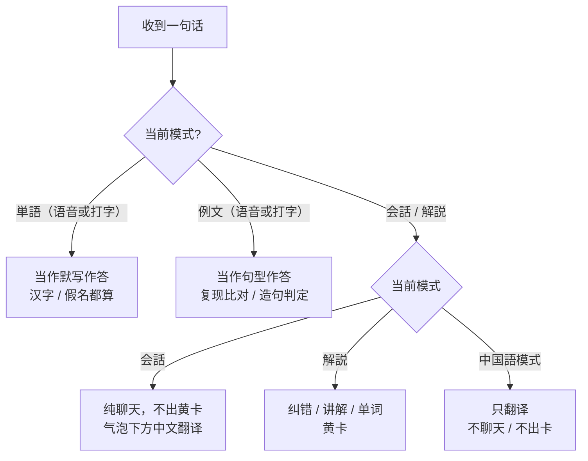
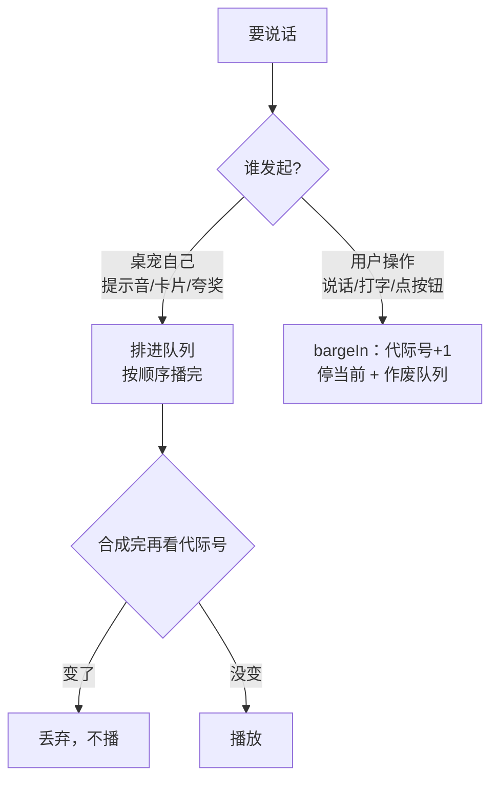

# 界面与交互

模式、气泡、黄卡、回显、HUD、焦点与窗口尺寸。规则类内容见 [JAPANESE-RULES.md](JAPANESE-RULES.md)。

## 它有哪些模式

一共**四种模式**：**会話 / 解説 / 単語 / 例文**。
`会話` 与 `解説` 共用一个按钮（点一下互换）；`単語`、`例文` 各自独立。

| 模式 | 行为 |
|---|---|---|
| **会話** | 纯聊天：任何输入都不出黄卡；气泡下方固定中文翻译 |
| **解説** | 日本語模式下所有输入按日语处理；黄卡只放纠错 / 讲解 / 单词，气泡只做自然反应 |
| **単語** | 每日 20 词默写（批次与状态机见 [JAPANESE-RULES.md](JAPANESE-RULES.md)）；今日 10 个新词答完会提示，一批全部答过会出总结 |
| **例文** | 每日 5 个句型：复现（照打例句）或造句（用句型自己写一句），判定先规则后模型；出卡朗读、答对夸奖、答错鼓励、一批答完总结；造句“大概对”时停留讲评卡，点「下一句」再继续 |

- **语音**说完立刻发送；**打字**只按回车发送
- **说话时她会先停下**：按空格 / 点 🎤 会立即中断当前朗读，并在录音期间拒绝播放新音频（否则她的声音会被麦克风收进去）
- **她自己不会打断自己**：提示音、卡片语音都进同一条语音队列，按顺序播完
- **你的操作永远优先**：正在读单词/句子时点别的按钮，立刻停当前朗读 → 从「XXモード」念起 → 再自然过渡到下一段；
  切模式还会作废所有在途的朗读流程（旧流程不许再出声）
- 切换模式时会念一句很短的提示（かいわ / かいせつ / たんご / れいぶん モード）；同一模式重复点不再念。进入/退出復習也会念（「たんご復習モード」/「れいぶんモード」等）。**界面与卡片先切换（约 30ms），提示音随后才播**。提示语会看当前状态：
单词/例文若正处于復習中，切进去念的是「たんご復習モード / れいぶん復習モード」；
提示音与卡片语音之间留 400ms 停顿，避免听成一串。
这些短提示音（4 个模式 + 2 个復習 + level up/down 共 8 句）会缓存到 `.voice/cache/`，
启动后自动预热：首次合成约 1.4 秒，之后从点击到出声约 **100ms**。
- 语言按钮（`日本語 / 中国語`）决定"听/输入什么语言"：
  · **日本語模式**：所有输入都按日语处理；会話聊天、解説出卡、单词/例句答题
  · **中国語模式**：翻译模式；任何文本/语音都按中文原文硬翻译
  · 中国語模式不聊天、不答题、不换卡、不朗读；日语输入也按中文处理
- 会話/解説的回复**不标振假名**；振假名只在卡片和例句上

### 操作

| 操作 | 作用 |
|---|---|
| **按住空格**（窗口聚焦时） | 录音，松开发送 |
| **按住空格 → Esc** | 取消这段录音 |
| 按住右下角 🎤 | 录音；**向任意方向划 40px** 变红 = 松手取消 |
| 打字 → 回车 | 发送手打内容（输入法选词的回车不会误发） |
| 点 `会話/解説` | 在这两个模式间切换（切换时念一句「かいわモード」这类短提示） |
| 点 `単語` / `例文` | 进入单词 / 例文模式（两个独立按钮） |
| 造句后点 `下一句` | 大概对 / 有地道建议时，看完讲评卡再进入下一题 |
| 点各自的 `N5` | 弹下拉选档：全局（在 `会話` 下方）、单词（在 `復習` 下方）、例文（同样在 `復習` 下方）。换档会**立刻**念「レベルアップ / レベルダウン」（点击当下就排上语音，不等后端），并把该列状态复原（**復習中 → 復習**、换新批次） |
| 点 `新規` | 单词：换一批 20 个词；例文：换一批 5 个句型（都会先念一句提示） |
| 点 `復習` | 只循环错题本（单词/例文各管各的）；再点回每日。错题本为空时只在左上角 HUD 提示，卡片不动、模式不切 |
| 点气泡里的 ▶ | 再读一遍：**单词/例文模式读卡片内容**（词+例句 / 例句），会話/解説 只读该模式最后一条回复（模式提示音不算；没有回复时按钮隐藏） |
| 设置 → Live2D | 切换 Live2D 模型；取景可微调，「保存位置」存为该模型默认 |
| 点 ⚙ 或 `Cmd+,` | 打开设置窗口 |
| 间隔复习 | 答对后按 1 / 3 / 7 / 14 / 30 / 60 天再出现在每日批次；答错归零、明天再来；到期多时会多给复习位 |
| 单词判分的「也算对」 | 卡片是纯假名、你写了别的写法且**读音完全一致**时（如 かわいい→可愛い），「你的」那行最右会出现「这个也算对（记住）」；点一次写进该词的 `alts`，以后自动算对 |
| 振假名 | 她的日语回复、追问、例句卡、单词例句的汉字上方会标读音（kuromoji 分词）；读不懂可以直接看假名 |
| 会話模式 | 每轮会从你**学过的词**（连续答对毕业的）里挑 1–2 个，让她自然用进回复；放不进去就不硬塞；同一个词 7 天内不重复 |
| 右键 → 说话… | 让她主动搭一句话（LLM 现生成） |
| 右键 → 表情 | 当前模型可触发的表情 / 动作；按 model3、VTube Hotkeys、目录 exp3 自动列出，换模型自动变 |
| 右键 → 恢复默认大小 / 回到右下角 / 打开项目文件夹 / 退出 | 窗口与项目操作 |
| `Cmd+Ctrl+T` / `Ctrl+Alt+T` | 层级切换（mac: `floating` ⇄ `screen-saver`；Windows 只有 topmost 开关） |
| `Cmd+Ctrl+P` / `Ctrl+Alt+P` | 鼠标穿透开关 |

## 设置窗口

右键菜单 **設定…**（或 `Cmd+,`）打开一个独立窗口，改完立刻生效，不用重启：

窗口按 **9 组**分区，顺序为：

```text
资源 → Live2D → ASR → LLM → TTS → 记忆 → 快捷键 → 应用信息 → 学习记录
```

| 分组 | 内容 |
|---|---|
| **资源** | Live2D Core、Live2D 模型、ASR、VOICEVOX、AivisSpeech 的下载/状态/路径入口；「打开资产目录」显示当前实际写入根 |
| **Live2D** | **模型下拉**（自动扫描 `model/` 下的模型）+ 取景三值（倍数 / 左右 / 上下）；「应用」= 临时试看，「保存位置」= 存成该模型默认 |
| **ASR** | 后端（whisper.cpp / mlx）+ 模型下拉；点「应用」后才重启识别服务；**日志**开关（默认开）；提示文案按平台和实际模型目录显示 |
| **LLM** | 模型下拉（6 家服务商 / 14 个内置模型，Ollama 动态补充，**接口地址自动跟随**）、自定义模型、API key、「测试连通」 |
| **TTS** | 引擎（VOICEVOX / AivisSpeech）+「应用」；声线（当前引擎角色）+「试听一句」；语速 / 音高 / 语调 / 音量 |
| **记忆** | 查看/编辑/删除 profile、关系、最近经历；只显示摘要，不显示聊天原文 |
| **快捷键** | 标题旁可一键**开启/关闭**全部快捷键。全局 4 个：显示/隐藏、录音开关（`⌥Space`，停顿自动发送，阈值默认 1.2 秒、1–5 秒可调）、静音、聚焦输入；窗口内 5 个：`F1`–`F5`（会話/単語/例文/重读/静音）。点「改键」按下新组合，Esc 取消 |
| **应用信息** | **开机自启**（仅打包版显示，默认关闭） |
| **学习记录** | 导出 / 导入 / **从备份恢复** / 清空当前档位 / 清空全部（操作前自动备份，保留最近 7 份）；也算对记录管理；「打开数据目录」 |

TTS 的引擎切换是显式的：改下拉不会立刻切，点「应用」才停旧引擎、起新引擎；切换期间下拉和按钮禁用，声线显示「引擎启动中…」。

选模型时会**自动套用该模型保存过的取景**；之后微调只影响这次，点「保存位置」才会写回默认。

模型目录在 [`agent/providers.js`](../agent/providers.js)（6 个服务商 / 14 个内置模型；Ollama 读取本机已安装模型）。目录里没有的选「自定义…」，手填模型名 + 接口地址（地址默认沿用当前值）。
没配 key 时「测试连通」会回退去探测本地 Ollama，纯离线用户也能测。

`.env` 里这几个键会由设置窗口自动维护：`LLM_API_KEY`、`LLM_MODEL`、`LLM_BASE_URL`（选 Ollama 时连带 `OLLAMA_*`），写文件时用临时文件 + rename，权限保持 `0600`。

> 学习水平不在这里——桌宠顶部有三个 `N5` 按钮管它（全局 / 单词 / 例文），避免两处重复。

实现要点：

- **两个窗口两套 preload**：桌宠窗口是 `preload.js`，设置窗口是 `preload-settings.js`。
  设置窗口拿不到 `speak / asr / chat / saveAudio / quit`。
- 主进程还会用 `sender` 校验，确保 `cfg:*` 只能被设置窗口调用。
- 配置只有**一个写者**：都在主进程里走 `agent/config.js`（原子写 `data/settings.json`），
  改完广播 `cfg:changed` 给桌宠窗口，标签与声音立刻更新。

## 界面一致性（`ui.css`）

两个窗口共用一份设计令牌，避免"每个新组件现调一遍像素"：

| 类别 | 令牌 | 说明 |
|---|---|---|
| 圆角 | `--r-xs / -sm / -md / -lg / -pill` | 8 / 10 / 12 / 16 / 999px |
| 底色 | `--surface-0 / -1 / -2` | 输入框、浮层、气泡 |
| 描边 | `--border` / `--border-strong` | 常态 / 悬浮与聚焦 |
| 文字 | `--text` / `--text-dim` / `--text-faint` / `--text-accent` | 四级层次 |
| 强调 | `--accent` / `--accent-strong` / `--accent-soft` / `--ok` / `--warn` | 主色与状态色 |
| 字号 | `--fs-xs / -sm / -md / -lg` | 11 / 12 / 13 / 15px |

约定：

- 两个页面都 `<link rel="stylesheet" href="ui.css">`，**新样式只用 var()**，不再写死颜色和圆角
- 滑块是自绘轨道（`--fill` 变量控制已填充比例），不依赖系统配色，换 macOS 版本不会变样
- 静态服务白名单里要放行 `ui.css`（已加）

## 黄卡（`#note`）的结构

三种模式共用同一条"从上到下"的信息顺序，这样切模式时眼睛不用重新找位置：

| 层 | 标签 | 内容 |
|---|---|---|
| **内容** | `意思` `接续` `例句` `读音` `备注` | 这题考什么 / 她给了什么 |
| **我的输入** | `你的` | 你打的句子 |
| **判定** | `点评` `问题` `纠错` | 对错与原因（问题最多 2 条） |
| **参考** | `改` `例句` `键盘` `讲解` `单词` `说法` | 正确说法、怎么打出来、补充讲解 |
| **进度** | `进度` | 今日统计（**只有统计行用**） |
| **台词** | —（暗色、无标签） | 她的鼓励/夸奖，放最末 |

细节约定：

- 标签统一 34px 宽、灰字（`.lbl`），所以三张卡片的标签列天然对齐
- 台词用 `.say` 暗色，不占标签列——它是"她说的"，不是学习信息
- 操作指令（`—— 用日语打出这个词…` / `—— 再打一次`）不加标签
- 卡片刻朗读的内容用 `.hl` 半透明底色常亮标出
- 罗马字用 `.romaji`，可以在「键盘」标签后任意折行

## 输入路由



## 语音队列与优先级



三条规则：

1. **桌宠不打断自己**：提示音、卡片语音都在同一条链上排队
2. **用户永远优先**：`bargeIn()` 会停当前播放并把队列作废（旧任务按代际号跳过）
3. **合成窗口也要挡**：`speakNow()` 在合成返回后再查一次代际号——否则用户点完之后，那 0.2–1.4 秒里合成完的旧语音仍会冒出来

另外：**暂停旧音频时必须手动兑现它的 Promise**，否则等待链会挂住（`dailyBusy` 卡死 → 打字/切模式全部无反应）；有 45 秒兜底强制兑现。

---

## 界面显隐：只有一张表

「某种模式下哪些元素该出现」全部写在 `pet.js` 的 `MODE_UI` 里，由 `applyModeUI()` 统一应用：

```js
const MODE_UI = {
  conv:    { gLevel: true,  batch: false, review: false, wrong: false, wordLv: false, patternLv: false },
  teach:   { ...同 conv },
  word:    { gLevel: false, batch: true,  review: true,  wrong: true,  wordLv: true,  patternLv: false },
  pattern: { gLevel: false, batch: true,  review: true,  wrong: true,  wordLv: false, patternLv: true },
};
```

以前这些判断散在 `setMode` / `refreshWordUI` / `refreshPatternUI` / `initLevelUI` 四处，
谁最后执行谁生效，出过「会話模式残留错题数」「復習中换档不重置」这类 bug。

规则：**加界面元素时，先在表里加一列**，不要再往四个函数里塞 if。
`refreshWordUI` / `refreshPatternUI` 只负责数字与文案，显隐一律交给 `applyModeUI()`。

## 渲染帧率

Live2D 渲染按窗口状态降帧：

| 状态 | 例子 | 帧率 |
|---|---|---:|
| 前台活动 | 刚移动鼠标、打字、说话、表情/动作 | 60fps |
| 前台空闲 | 窗口在前台，但 3 秒没有交互 | 36fps |
| 失焦但仍可见 | 点去 Chrome / Finder，她还在桌面 | 36fps |
| 最小化 / hidden | 窗口不可见 | 暂停 ticker |

判定优先级：

```
hidden → 暂停
说话中 / 表情动作中 → 60
失焦但可见 → 36
前台且 3 秒内活动 → 60
前台空闲 → 36
```

实现：`renderer/model.js` 的渲染 governor + `renderer/audio.js` 的 `isAudioPlaying` / `audio-start` / `audio-end`。  
暂停只停画面，不停止音频进程；恢复可见/聚焦后自动继续。

## 窗口层级

```text
启动 / 隐藏后再显示：不抢焦点，不置顶
点击桌宠或显示快捷键：拿到焦点后才置顶
点击别的应用：失焦，取消置顶，不隐藏
```

原则：

```text
置顶时一定有焦点
无焦点时一定不置顶
```

`Cmd+Ctrl+T` / `Ctrl+Alt+T` 只切换层级；桌宠没有焦点时只记住层级，等下次 focus 再应用。

## 快捷键（agent/shortcuts.js）

- 两类：`global` 走 `globalShortcut`（必须带修饰键），`local` 走渲染层 keydown（可单键）
- 默认值按平台算（`platform.shortcutMod()`），改动存 `data/shortcuts.json`，坏值回落默认
- 窗口内默认用 **功能键 F1–F5**：字母/数字会和输入框打字抢（输入框聚焦时我们只放行
  不产生文字的键），功能键没这个问题
- 改窗口内键后主进程会发 `pet:shortcuts-changed`，渲染层重新拉映射
- 注册失败（被别的应用占用）只打日志 + 设置里提示（键位显示成红色），不阻塞启动
- mac 默认：显示/隐藏 `⌥H`、录音 `⌥Space`、静音 `⌥M`、聚焦输入 `⌥J`
- Windows 默认：显示/隐藏 `Ctrl+Alt+H`、录音 `Ctrl+Alt+Space`、静音 `Ctrl+Alt+M`、聚焦输入 `Ctrl+Alt+K`
- 录音默认 `⌥Space`（Superwhisper 的惯例）；切换式录音带**静音自动结束**：
  说满一句后静音 N 秒自动停止发送（默认 1.2s，可在设置里 1–5s 调，存 shortcuts.json 的 autoStopSec；
  `rec.js` 里 `rec.lastVoice` + 200ms 轮询），
  按住空格的路径仍然是松手结束
- 总开关存在 `shortcuts.json` 的 `enabled`；关闭后主进程不注册、渲染层不响应，
  但键位配置保留（再打开原样恢复）
- Electron 的 `globalShortcut` 只有按下事件、没有松开；真正「全局按住说话」需要
  原生键盘钩子（CGEventTap / WH_KEYBOARD_LL），暂时不做

## 挂件窗口大小

- 两个手柄：右下 `#resizeHandle`、左上 `#resizeHandleTL`（22×22，`nwse-resize`，
  `-webkit-app-region: no-drag`）；拖右下角时**左上角固定**，拖左上角时**右下角固定**；
  渲染层把 PointerEvent 的 `screenX/screenY` 发给主进程（这是光标屏幕坐标，窗口自己移动不影响）
- 主进程 `petResize(sx, sy, corner)` 按角算宽高，`applyPetSize(..., { anchor })` 负责
  夹到「240×320 ~ 工作区 90%」并保持窗口不超出工作区
- 松开（`pet:resize-end`）才写 `data/window.json`，拖拽过程不落盘
- 右键菜单「恢复默认大小」调 `resetPetSize`（main.js 注入 `windowSvc.setPetSize(DEFAULT)`）；
  设置窗口的宽/高走同一个 `applyPetSize(..., {save:true})`；「恢复默认」用
  `agent/window-size.js` 的 `DEFAULT`（380×560），通过 `cfg:pet-size` 一起返回给设置窗口
- 注意：`petOn` 收到的参数**不含 event**（`ipcOn` 已经剥掉），handler 直接写 `(x, y)`；
  写成 `(e, x, y)` 会拿到 undefined —— 这个踩过一次

## 「再读一遍」的重播目标

- 三种文本分开存（`renderer/state.js`）：
  · `lastCardSay`：卡片正文（单词+例句 / 例句）
  · `lastConvSay`：会話/解説的最后一条回复
  · `lastContentSay`：其它内容（搭话等）
  · `lastSpoken`：最近一次朗读（含模式提示音，只作诊断）
- 模式提示音走 `speakNow(text, { replay: false })`，不写 `lastConvSay`
- 重播按钮：卡片模式读 `lastCardSay`；会話/解説读 `lastConvSay`；没有目标就隐藏
- 输入框焦点：只有手动点输入框（或显式的「聚焦输入框」快捷键）才聚焦；
  录音结束、点语言/设置/重播都不抢焦点
- 录音结束从不抢输入焦点：`finishRec` 的 finally 不调用 `input.focus()`（任何录音来源都一样）

## 纠错 why_zh 与讲解 explain_zh 的分工

- prompt：`why_zh` 只写这一句的具体原因（≤40 字），`explain_zh` 讲规律/对比/扩展，禁止重复
- UI（`renderer/cards.js` 的 `showNote`）：
  · 有 `explain_zh` 且与 `why_zh` 重合（去标点后包含，或 bigram Dice ≥0.6）→ 只显示讲解
  · 没有讲解时照常显示 `why_zh`（会話模式常见）
- 阈值 0.6 是经验值：太高漏去重，太低会吞掉具体细节

### 设置 → 资源

| 行 | 内容 |
|---|---|
| Live2D Core | 「下载 SDK」→ Cubism SDK for Web；状态：`已找到/未找到` |
| Live2D 模型 | 「下载 Hiyori」→ Live2D 官方示例页；状态跟随 `LIVE2D_MODEL` |
| ASR | ASR 状态；模型目录/后端提示按平台显示（Windows 不再提示 mlx） |
| Aivis 声线 | 拖入 `.aivmx`；状态与安装 |
| VOICEVOX | 「下载 VOICEVOX」+ 状态 + 路径 +「选择路径」 |
| AivisSpeech | 「下载 AivisSpeech」+ 状态 + 路径 +「选择路径」 |

- 状态行可点击打开对应目录；悬停显示完整路径
- 两个引擎的路径分别编辑：VOICEVOX 写 `VOICEVOX_ENGINE`，Aivis 写 `AIVIS_ENGINE`
- 选择路径只保存，不自动切换引擎；TTS 里点「应用」才启动
- 路径校验要求选到 `vv-engine/run` 或 `AivisSpeech-Engine/run`（Windows 为 `run.exe`）
- 未找到时显示「未找到」，并告诉用户放哪

- 只打开系统浏览器，不内嵌、不自动下载、不打包
- 模型/Core/引擎由用户自备，见 [ASSETS.md](ASSETS.md)

---

## 点词查询

- 范围：会話/解説气泡里的日语正文；黄卡与例文卡的**例句**（`.jp`）
- 不处理：目标词本身、中文翻译/讲解、回显、标签、按钮、输入框
- 数据：`agent/lookup.js` = kuromoji 分词 + 词表（`data/jlpt.json`，10,109 词）
- 只标记词表里**有释义**的词；词表外不可点、无下划线
- 匹配优先原形（見た → 見る）
- 点击弹浮层：表层、读音、原形、中文释义、等级/词性
- 浮层小喇叭：朗读该词，用词表读音（避免多音字）；`say(..., {interrupt:true})`，会打断当前语音，
  但**不更新**「再读一遍」的目标
- 实现：`renderer/lookup.js`，在 `showReply` / `noteShowHTML` 之后异步增强；旧节点断开后自动丢弃
- 分词缓存上限 200 条（LRU）；新回复 / 切模式会收起浮层
